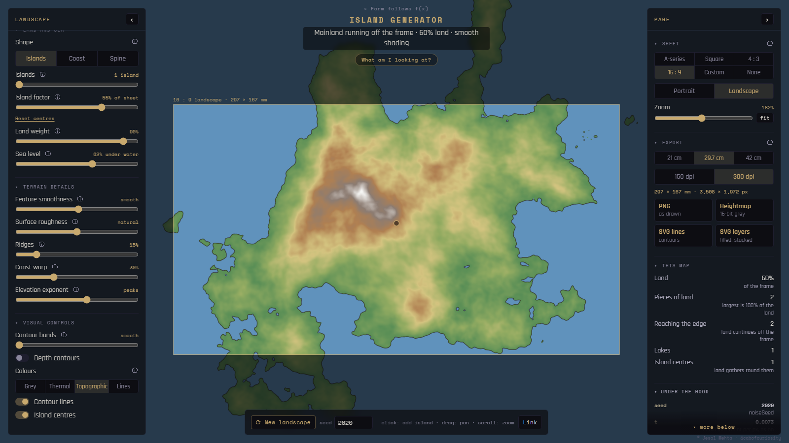
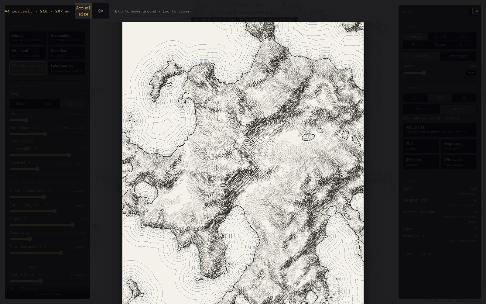
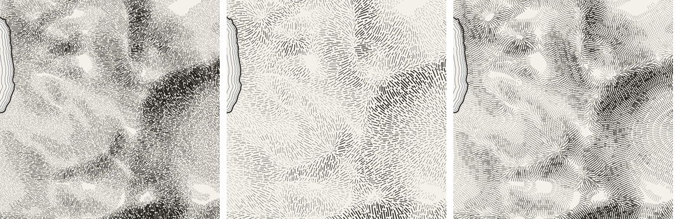

# Geo-Graphic

*A procedural landscape and cartographic drawing tool.*

Geo-Graphic turns seeded noise into a landscape and draws it as a map: grey or coloured contour bands, topographic tints, contour lines on paper, or engraved hachures and stipple. One set of controls moves it between a single island, an archipelago, a coastline, a mainland and a mountain range. You choose what part of the landscape sits in a frame of a chosen shape, set a print size, and export a print-resolution PNG, a 16-bit heightmap, or SVG vectors for plotting and layered cutting.

**Formerly *Island Generator*.** It grew out of the author's hand-coded *Perlin Contour* sketches of 2020, and from 2026 it was redeveloped with AI assistance. The older screenshots below still show the former name; the internal JavaScript namespace (`IG`) keeps its original initials.

There is no public hosted demo yet. To try it, run it locally (below).

- [Development history](HISTORY.md): from the 2020 sketches to the current tool
- [Technical notes](docs/TECHNICAL.md): terrain, contours, engraving, rendering and export in detail
- [Credits](CREDITS.md): authorship, AI assistance, methods and dependencies
- [Archive](archive/README.md): selected original p5.js sketches, 2020–2021



*A 16 : 9 frame zoomed in on the landscape, with smooth (unbanded) Topographic shading. The faded terrain outside the frame is landscape that isn't exported. This screenshot is from v5.5 under the former name, before Engraved and Actual size were added; the controls shown otherwise match the current version.*

## Quickstart

1. Run the page (see [Running it locally](#running-it-locally)) and pick a **preset**, for example *Island* or *Mountain range*.
2. Press **⟳ New landscape** (or <kbd>N</kbd>) until you like the terrain, or type a **seed**.
3. Click the map to add an island centre, drag a marker to move it, double-click a marker to remove it.
4. Choose a **Shape** (Islands, Coast or Spine) and adjust **Island factor**, **Land weight** and **Sea level**.
5. Pick **Colours**: Grey, Thermal, Topographic, Lines or Engraved (keys <kbd>1</kbd>–<kbd>5</kbd>).
6. On the right, choose a **Sheet** ratio, then drag to pan and scroll to zoom until the frame holds what you want.
7. Choose a **print size** and **dpi**, check the detail with **Actual size** (<kbd>P</kbd>), and export.

## Running it locally

Five static files, no build step:

```text
index.html             page markup, help text, script order
geo_graphic.css        styles
model.js               terrain, levels, contours, engraving (no DOM, no p5)
ui.js                  settings, controls, map facts, URL state
geo_graphic.js         the p5 sketch: view, rendering, export
```

Open `index.html` in a browser, or serve the folder with any static file server:

```sh
python -m http.server 8000
# then open http://localhost:8000/
```

It needs a network connection for p5.js 1.9.0 (cdnjs) and the Space Mono and Rajdhani fonts (Google Fonts). The scripts are plain (not ES modules) and must load in order: p5 → `model.js` → `ui.js` → `geo_graphic.js`. The heightmap export also needs the browser's `CompressionStream` API (see [Browser and performance limits](#browser-and-performance-limits)).

## The landscape

### Presets, seeds and island centres

- **Presets** (Island, Archipelago, Mainland, Coastline, Mountain range, Lake country) are named settings within one shared set of controls, not separate modes. A preset sets the terrain controls and sea level and leaves the look (colours, bands) as you have it.
- **Seed** (0–999999) fixes the noise and the generated centres, so a seed and the same settings always give the same landscape. **⟳ New landscape** picks a random seed.
- **Island centres** are where land is pulled up. They are generated from the seed (**Islands**: 1–16) and can be edited: click to add, drag to move, double-click to remove; **Reset centres** returns to the generated set. Edits to generated centres are forgotten when the seed, the island count or the shape changes, because the generated set is then a different one. Clicking the map while Land weight is 0 turns Land weight on (to 85 %) so the new centre has an effect. **Island centres** under Visual controls shows or hides the markers; with markers hidden, clicks don't add centres.

### Land and sea

| Control | What it does |
|---|---|
| **Shape: Islands** | Land rises around each centre; nearby centres merge smoothly. Many small centres make an archipelago. |
| **Shape: Coast** | Land rises towards one side of the landscape. A single marker sets which side: drag it to turn the coast. |
| **Shape: Spine** | Land rises along a line joining the centres in order (generated centres are ordered top to bottom; added centres join the end of the line). With one centre it behaves like Islands. |
| **Island factor** | How far each centre's pull reaches, as a share of the landscape's width (8–120 %). For Coast, how far inland the land reaches. |
| **Land weight** | How strongly land gathers around the centres. At 0 the centres are ignored and land runs to every edge, like a mainland. Picking a Shape while it is 0 turns it back on. |
| **Sea level** | The share of the landscape that is under water (0–98 %). |

### Terrain details

| Control | What it does |
|---|---|
| **Feature smoothness** | How large the landforms are: smoother means fewer, broader hills. |
| **Surface roughness** | How much fine detail sits on top of the large shapes. |
| **Ridges** | Blends in sharp, branching crests, like mountain chains, with smooth valleys between. |
| **Coast warp** | Bends the whole terrain so coastlines and hills wander instead of looking round. |
| **Elevation exponent** | Raises heights to a power. Below 1: broad plateaus. Above 1: low ground spreads and peaks sharpen. With Land weight at 0, the coastline stays exactly where it is; with Land weight above 0, the amount of sea stays the same but the coastline can shift a little (see [TECHNICAL.md](docs/TECHNICAL.md#sea-level)). |

## Drawing styles

| Style | Key | What it shows |
|---|---|---|
| **Grey** | <kbd>1</kbd> | Height as grey bands, near-black sea |
| **Thermal** | <kbd>2</kbd> | Height as colours from cold to hot |
| **Topographic** | <kbd>3</kbd> | Map colours: blue sea (with lighter shallows when Depth contours is on), green lowlands, brown hills, grey rock and snow |
| **Lines** | <kbd>4</kbd> | Contour lines on paper; the coast is heaviest and every fifth level is an index contour |
| **Engraved** | <kbd>5</kbd> | The land drawn in pen strokes, with water lines following the coast out to sea; **Hachures** or **Stipple** |

- **Contour bands** (0–30): the number of steps from the coast up to the highest point. At **0** the shading is smooth and unbanded, and contour lines show only the coast.
- **Depth contours** shades the sea from shallow to deep, in the same number of bands as the land (from the coast down to the deepest point), and adds depth lines to the contour drawings. With it off, the sea is one flat colour.
- **Contour lines** draws the contours over Grey, Thermal, Topographic or Engraved. In Lines style they are always on, so the toggle is shown on and greyed out.

### Engraved: hachures and stipple

Both modes draw strokes down the slope, heavier where the ground is steep and on slopes facing away from the light, with near-flat ground left white. The coast is always drawn, and ten water lines follow it out to sea, spaced further apart as they go.

- **Hachures** are rows of strokes running down the slope from one contour to the next, on finer rows than the display bands (at least 4 per band and 48 in all). **Stroke length**: 1–2.5 mm, or *off* at the far right, which lets every stroke run from contour to contour. Shorter caps leave a little white on gentle ground.
- **Stipple** is loose strokes not tied to contours, from 0.4 mm on gentle ground up to **Stroke length** (1–5 mm) on the steepest. **Spacing** (0.2–0.5 mm) sets how close strokes may come: closer is denser and darker; long strokes set far apart start to look like fur.
- **Light from** (0–360°, default 315°, north-west, the traditional map convention) sets the sun direction. Moving it only changes stroke weights, so it is quick.

All engraving sizes are in **millimetres of the printed sheet**. At the fitted on-screen view an A4 sheet is only about 2.5 px per mm, too coarse to show strokes cut in fractions of a millimetre, so the screen shows engraving mainly as tone. Use **Actual size** to see the real detail.



*Actual size preview (Engraved, Hachures, Mountain range preset) of an A4 sheet at about true size on a typical screen. Screenshot from v5.8, under the former name.*

## Landscape, frame and print size

Three things are kept separate:

1. **The landscape**: an endless terrain. Its central unit square holds the generated centres and is the reference for sea level, so nothing about the landscape depends on the sheet.
2. **The frame**: a **Sheet** ratio (A-series, Square, 4 : 3, 16 : 9 or Custom W : H, portrait or landscape) fitted into the middle of the window. **Zoom** (25–1600 %; scroll, or the slider; **fit** or <kbd>F</kbd> to reset) and **pan** (drag the map) choose which part of the landscape sits inside the frame. That part is what gets exported, what *This map* describes, and what a link restores. Changing the ratio re-frames the landscape; it never rebuilds it. **None** removes the visible frame and uses the whole free area of the window as the frame.
3. **The print**: **print size** is the long edge of the sheet (21, 29.7 or 42 cm; labelled A5, A4 and A3 for A-series) and **dpi** is 150 or 300. Together they set the export's pixel size, shown under the buttons (for example `210 × 297 mm · 2,480 × 3,508 px`). Line and stroke widths are in millimetres of print, so the screen is scaled to the print.

The *This map* panel describes the framed area: land share, pieces of land, how many reach the edge, lakes and the number of centres. Its land share is of the frame, while the Sea level slider is a share of the landscape's reference square, so the two percentages don't usually add up to 100.

## Actual-size preview

**Actual size** (or <kbd>P</kbd>) renders the sheet exactly as the PNG export would and shows it in an overlay at **Actual size** (the sheet's millimetres at the CSS standard of 96 px per inch, which is roughly true size on a typical screen but not calibrated) or **2×**. Drag to move around; <kbd>Esc</kbd> or ✕ closes it. It takes about as long as an export, because it is one.

## Export

| Button | Output |
|---|---|
| **PNG** | The frame as drawn, at print size × dpi, in the current style. |
| **Heightmap** | A 16-bit greyscale PNG of height, for 3D or CNC use (at most 300 dpi). |
| **SVG lines** | Every contour as a line, one Inkscape layer per level, in millimetres: for plotters and laser engraving. |
| **SVG layers** | Every level as a filled shape (the whole region above that height), stacked bottom to top: for layered cut models. |

Things to know:

- **Exports cover the frame**: the landscape inside it at the chosen print size, never the window.
- **PNG** size is capped at 60 megapixels. Above that the dpi is reduced and the page says "(size capped)". The terrain is sampled at up to about 5 million points and interpolated up to print resolution; bands are cut from the interpolated heights, so band edges stay clean.
- **Heightmap** values are **normalised to the frame**: the lowest point inside the exported area becomes 0 and the highest 65535. They aren't absolute heights, and two different crops of the same landscape aren't on the same scale. The sea is not flattened.
- **SVG** paths are traced from a grid of up to 4 samples per millimetre and simplified to within 0.08 mm, so they're a close vector approximation of the terrain, not an exact one. Lines stay open where they leave the frame, so a plotter doesn't trace the border. In Engraved style, *SVG lines* also contains the water lines and the hachure or stipple strokes, grouped by stroke weight.
- **SVG metadata**: each SVG starts with a comment holding the version, the seed and the settings part of the page's link (`?s=…`), so a file records how it was made. Add those settings to the tool's address to reopen the map. The page address itself isn't included.
- File names record the seed, sheet size, style and dpi, for example `geo-graphic-2020-210x297mm-hachures-300dpi.png`.



*Crops from A4 exports, left to right: Stipple at 0.2 mm spacing, Stipple at 0.5 mm, and Hachures. Made in v5.8 to show that the exports differ even where the fitted screen view looks the same.*

## Shareable links

Every setting is written into the page's address as you change it, with short keys and only non-default values. This includes the seed, all terrain and style controls, the sheet, print size, dpi, zoom and pan, and centre edits (added, removed and moved centres). **Link** copies the address, and opening it reproduces the same framed map. Collapsed sections and panels are remembered per browser, not in the link.

## Keys and mouse

<kbd>N</kbd> new landscape · <kbd>1</kbd>–<kbd>5</kbd> styles · <kbd>F</kbd> fit the frame · <kbd>P</kbd> actual size · <kbd>H</kbd> hide the interface · <kbd>Esc</kbd> close dialogs

Click: add a centre · drag a marker: move it · double-click a marker: remove it · drag the map: pan · scroll: zoom about the pointer. Help for each control is behind its ⓘ icon (hover on desktop, tap on touch screens). On screens 900 px wide or narrower, the panels become bottom sheets.

## Browser and performance limits

- **Everything runs in the browser.** There is no server: terrain, contours, engraving and file encoding are computed on the visitor's machine, on the page's main thread.
- **On screen**, the terrain is sampled progressively (a quick coarse pass, then finer passes spread across frames), so sliders stay responsive while the full-resolution picture settles. Engraving is traced a slice at a time between frames.
- **Exports and the preview** spread terrain sampling across short slices, but tracing the engraving for an export runs in one go, so the page can pause for a few seconds on a large sheet. Development measurements for an A4 sheet at 300 dpi were roughly 4–6 s for Engraved and a few seconds for other styles, on the developer's desktop. These aren't benchmarks.
- **Heightmap** export needs `CompressionStream` (Chrome 80+, Firefox 113+ and Safari 16.4+ according to their published support; not tested on each).
- **Phones:** pinch-zoom isn't supported (use the Zoom slider), and the layout hasn't yet been checked on physical phones or high-DPI desktops.
- **Links** with very long lists of added or moved centres are accepted without a length limit, so an unusually long link can make the page slow.
- **Fabrication:** the SVG layers and lines haven't yet been tried in Inkscape, laser-cutting software or on a plotter.
- **Network:** p5.js and the fonts come from CDNs, so the page doesn't work offline as shipped.
- The "← Form follows f(x)" link goes to the FFFX site (`fffx.cabinetofcuriosities.in`), where the tool is meant to be found, and the page title ends in "— Form follows f(x)". Some source comments refer to a design document (`ISLAND-GENERATOR.md`) that isn't part of this repository.

## Licence and terms

- **Application code** (`index.html`, `geo_graphic.css`, `geo_graphic.js`, `model.js`, `ui.js`): © Jesal Mehta, licensed under the **GNU General Public License v3.0 or later** ([LICENSE](LICENSE)). You may use, study, change and share it; if you distribute a modified version, including by hosting it on a website, you must make its source available under the same licence. Third-party components keep their own licences (see [CREDITS.md](CREDITS.md)).
- **Historical sketches** in [`archive/`](archive/README.md) stay under the author's original notice: copyright Jesal Mehta; the output is free to use for non-commercial purposes; contact the author for a different licence. The code licence doesn't cover them.
- **Screenshots and documentation:** © Jesal Mehta, all rights reserved.
- **Maps and drawings you make with the tool** belong to you, for **non-commercial use only**. When you share them, credit Jesal Mehta or tag @cabofcuriosity.
